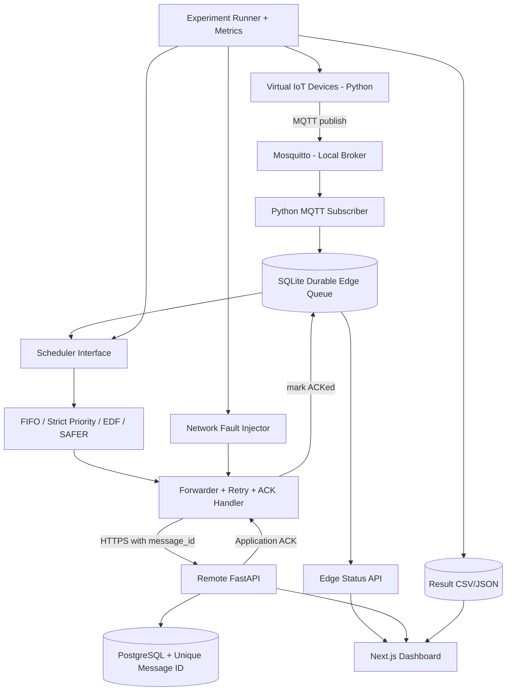

# SAFER — Software-Only IoT Data Scheduling & Recovery Research Platform

> **Status:** Project specification / implementation handoff (not a completed system)  
> **Language:** Thai for requirements and documentation; English for code, naming, API fields, and technical identifiers  
> **Target:** End-to-end software development, reproducible research experiments, and cloud deployment  
> **Hardware requirement:** **None in MVP and research evaluation** — all IoT devices are simulated.

---

## 0. คำสั่งเริ่มต้นสำหรับ OpenAI Codex / ChatGPT Work

คุณคือ Senior Software Engineer + Distributed Systems Engineer + Research Engineer รับผิดชอบพัฒนาโครงการนี้ตามสเปกนี้ โดยให้ **ทำทีละ Milestone** และส่งมอบผลลัพธ์ที่รันและทดสอบได้จริง ไม่ใช่ UI Mockup หรือสร้างไฟล์เปล่าจำนวนมาก

**แนวทางทำงานที่ต้องปฏิบัติ:**

1. อ่านสเปกนี้ทั้งหมด ตรวจสอบข้อขัดแย้งและความเสี่ยง ก่อนสร้างโค้ดสรุป Architecture และแผน Milestone สั้น ๆ ใน `docs/architecture.md` และ `docs/plan.md`.
2. เริ่ม Milestone M0 แล้วทำ M1 → M2 → ... ตามลำดับ; แต่ละ Milestone ต้องมี code, test, run command, acceptance evidence, และบันทึกสิ่งที่ยังไม่ทำ.
3. เลือกชุดเทคโนโลยีที่ระบุด้านล่างเป็นค่าเริ่มต้น หากเปลี่ยนต้องเขียน ADR (Architecture Decision Record) พร้อมเหตุผล.
4. โค้ดที่พัฒนาต้องรันได้ด้วย Docker Compose บนเครื่อง Windows 11 ที่มี Docker Desktop/WSL2 โดย **ไม่ต้องมี ESP32 หรือ Sensor จริง**.
5. ตั้งค่าเริ่มต้นเป็น local/dev; ห้ามใช้เงินจริง, เปิด Public endpoint, Deploy Cloud, เพิ่ม/แก้ GitHub remote, ลบข้อมูลถาวร หรือสร้าง resource ที่มีค่าใช้จ่ายโดยไม่ได้รับอนุญาต.
6. ไม่ต้องถามรายละเอียดเล็กน้อยที่แก้ได้ด้วยค่า default ที่สมเหตุสมผล ให้ระบุสมมติฐานใน `docs/decisions.md`.
7. ห้ามรายงานว่าระบบ Production Ready หรือ SAFER ดีกว่า baseline หากยังไม่มีหลักฐานการทดสอบจริง.
8. สำหรับขั้นตอนที่ต้องใช้ Credential, GitHub/Cloud access, หรือการยืนยันจากเจ้าของโปรเจกต์ ให้หยุดเฉพาะขั้นตอนที่ต้องใช้สิทธิ์นั้น และรายงานคำสั่ง/วิธีการที่เหลือ.

**นิยามของความสำเร็จ:** สามารถสร้างข้อมูล IoT จำลอง, ตัด/คืนเครือข่าย, เก็บ backlog, จัดลำดับการส่งด้วย SAFER และ baseline, ยืนยัน ACK, แสดงผล Dashboard, ทำการทดลองซ้ำด้วย seed เดิม, export ผล, และ Deploy Remote API/Dashboard บน Cloud เมื่อได้รับอนุญาต.

---

## 1. ภาพรวมโครงการ

### 1.1 ชื่อหัวข้องาน (working title)

**การพัฒนาอัลกอริทึมจัดตารางการส่งและกู้คืนข้อมูล IoT ภายใต้เครือข่ายไม่เสถียร**  
**SAFER — Semantic-Aware Freshness and Event Recovery**

> คำว่า *Recovery* ในโครงการนี้หมายถึงการ **ส่ง backlog ที่ค้างอยู่ให้ครบหลังเครือข่ายกลับมาใช้งานได้** ไม่ใช่การกู้ไฟล์ที่เสียหาย และตัว SAFER เป็น **scheduler จัดลำดับการส่ง** ไม่ใช่โปรโตคอลสื่อสารใหม่

### 1.2 ปัญหาที่ต้องแก้

IoT Gateway อาจรับข้อมูลจากอุปกรณ์ภายในได้ตามปกติ แต่ส่งออก Internet ไป Remote Server ไม่ได้ชั่วคราว ทำให้ข้อความสะสมเป็น backlog เมื่อเครือข่ายกลับมาแล้ว Gateway ต้องแย่ง bandwidth ที่มีจำกัดเพื่อส่งทั้ง:

- **Event:** เหตุการณ์/การแจ้งเตือนสำคัญที่ควรถึงก่อน deadline
- **Live State:** ค่าสถานะปัจจุบันซึ่งต้องการความสดใหม่ (freshness)
- **History:** ข้อมูลย้อนหลังที่ต้องครบถ้วนเพื่อวิเคราะห์และตรวจสอบ

การส่ง FIFO อย่างเดียวอาจทำให้ Event ช้า, การให้ Priority เข้มงวดอาจทำให้ History อดส่ง, และ EDF มองเพียง deadline โดยไม่ครอบคลุม freshness/history recovery ในตัวเอง

### 1.3 เป้าหมาย

สร้างแพลตฟอร์มซอฟต์แวร์เพื่อ **ออกแบบ ทดสอบ และเปรียบเทียบ** scheduling policy ภายใต้สภาวะเครือข่ายที่เปลี่ยนแปลงได้ โดยไม่สมมติว่า SAFER ชนะทุกกรณี ต้องรายงาน trade-off และกรณีที่ SAFER ทำได้แย่ด้วย

### 1.4 ผู้ใช้หลัก

- นักวิจัย/นักพัฒนาที่รันการทดลองและปรับ parameter ของ scheduler
- ผู้ดูแลระบบที่ดูสถานะ Queue, Network, ACK, Event และผลทดลองผ่าน Web Dashboard

---

## 2. ขอบเขตและสิ่งที่ไม่ทำ (Scope)

### MUST — MVP + Research Core

1. Virtual IoT Devices จำลองข้อมูลหลายอุปกรณ์ที่กำหนดอัตราส่งและ seed ได้
2. MQTT Broker ในเครื่องหรือ Docker และ Subscriber ที่เขียนข้อมูลลง Durable SQLite Queue
3. สามกลุ่มข้อมูล Event, Live State, History พร้อม Metadata ตามชนิด
4. จำลอง Link down/up, bandwidth, latency, jitter, loss, reconnect ได้แบบ reproducible
5. Scheduler 4 ตัว: FIFO, Strict Priority, EDF, และ SAFER (candidate policy)
6. Forwarder ส่งข้อมูลไป Remote HTTP API พร้อม ACK, retry, idempotency/dedup และ reconnect
7. Remote Server + PostgreSQL เก็บข้อมูลและสถานะการรับ
8. Web Dashboard แสดงสถานะระบบ, Queue, Graph, Events และผลเปรียบเทียบ
9. Experiment Runner แบบกำหนด workload/scenario/seed รันหลายรอบและ export CSV/JSON
10. Automated tests, Docker Compose, CI, เอกสารวิธีรันและ architecture
11. ทางเลือก Deploy Remote API + Dashboard ไป Google Cloud Run เมื่อได้รับอนุญาต

### SHOULD — After MVP

- Experiment report ที่แสดง p50/p95/p99 และ confidence interval
- Parameter tuning ของ SAFER แบบกำหนด version/config และเก็บผลครบ
- Queue compaction สำหรับ Live State พร้อม Audit ของรายการที่ถูกแทนที่
- Remote alerts แบบจำลอง/แสดงใน Dashboard

### OUT OF SCOPE ในเวอร์ชันแรก

- ESP32, Sensor จริง, SD Card, PCB, firmware
- ML/AI ที่ทำนาย bandwidth หรือสร้าง Adaptive Agent
- อ้างว่า QoS MQTT แทน Application ACK ได้
- ระบบชำระเงิน/ผู้ใช้จำนวนมาก/โมบายแอป
- Production SLA, HA multi-region, Kubernetes
- การทดลองบนระบบ Internet จริงที่ควบคุมปัจจัยภายนอกไม่ได้เป็นหลักฐานเชิงวิจัยเพียงอย่างเดียว

---

## 3. System Architecture



### 3.1 พื้นที่การทำงาน

**Local / Edge (Docker Compose):** Virtual Devices, MQTT Broker, Subscriber, SQLite Queue, Scheduler, Forwarder, Fault Injector, Edge Status API, Experiment Runner  
**Remote (local Compose ก่อน, Cloud ทีหลัง):** FastAPI ingestion endpoint, PostgreSQL, read API  
**Web:** Next.js Dashboard ที่รัน local ได้ และ deploy แยกได้

> **Cloud Run ไม่ใช่ที่วาง MQTT Broker แบบ long-lived TCP โดยตรงใน MVP.** ให้ MQTT อยู่ local/edge ก่อน; Remote API บน Cloud Run รับ HTTPS ขาเข้าได้ ขณะที่ Local Edge เป็นฝ่ายเชื่อมต่อออกเอง. หากเลือก Managed DB บน GCP ให้ประเมินค่าใช้จ่ายและการเชื่อมต่ออย่างปลอดภัย

### 3.2 Data flow กรณีปกติ / ขัดข้อง

1. Virtual Device สร้างข้อความพร้อม `message_id`, `device_id`, `category`, `created_at_utc`, `payload` และ metadata
2. Publish MQTT ไป Broker → Subscriber ตรวจรูปแบบและเขียนลง SQLite โดย commit ก่อนถือว่าเก็บสำเร็จ
3. Scheduler เลือกข้อความที่ยังไม่ได้ ACK ภายใต้ link budget และ fairness policy
4. Forwarder ส่ง HTTPS ไป Remote API โดยใช้ idempotency key (`message_id`)
5. Remote DB บันทึกด้วย unique constraint; **ACK หลัง durable transaction เท่านั้น**
6. Edge รับ ACK → เปลี่ยนสถานะเป็น `ACKED` แบบ durable; retry รายการเดียวกันต้องไม่สร้างข้อมูลซ้ำ
7. หาก Link down: หยุด outbound delivery แต่ยังรับและเก็บใน SQLite; กลับมาแล้วทยอย flush backlog โดย scheduler
8. หาก Remote รับและ commit แล้วแต่ ACK หาย: Edge retry → Remote ตรวจซ้ำและตอบ ACK เดิมแบบสำเร็จโดยไม่ insert ซ้ำ

---

## 4. Technology Stack ที่แนะนำ

| Layer | Technology | เหตุผล |
|---|---|---|
| Edge Simulator / Scheduler | Python 3.12+ | ทำ research algorithms และ simulation ง่าย |
| MQTT | Eclipse Mosquitto + paho-mqtt | จำลอง ingestion แบบ IoT จริง |
| Edge Store | SQLite (WAL) | Durable queue ในเครื่องเดียว; เหมาะกับ Edge MVP |
| Remote API | FastAPI + Pydantic | API contract/testability |
| Remote DB | PostgreSQL + SQLAlchemy/Alembic | Dedup ด้วย unique constraint และ schema migrations |
| Frontend | Next.js + TypeScript | Dashboard / charts / result pages |
| Experiment Engine | Python asyncio สำหรับ integration + **deterministic discrete-event core** | แยกการทดลองเชิงเปรียบเทียบจากความผันผวนของ runtime |
| Tests | pytest + Playwright (เมื่อมี UI) | Unit/integration/E2E |
| Tooling | Docker Compose, Ruff, mypy, GitHub Actions | reproducibility / quality gates |
| Cloud | Google Cloud Run (remote services) + Cloud SQL หรือ DB ที่รองรับ | แยก edge simulation ออกจาก remote hosting |

**ข้อกำหนดสำคัญ:** สร้าง Scheduler และ simulator core ให้ทดสอบแบบ Python ล้วน ๆ ได้ ไม่ผูกกับ MQTT, HTTP, SQLite หรือ Next.js เพื่อให้ทดลองซ้ำได้

---

## 5. Message/Data Contract

### 5.1 ข้อความมาตรฐาน

```json
{
  "schema_version": 1,
  "message_id": "uuid-v4",
  "device_id": "virtual-sensor-001",
  "category": "EVENT",
  "created_at_utc": "2026-11-06T09:00:00.000Z",
  "sequence_no": 128,
  "payload": { "metric": "temperature", "value": 41.2, "unit": "celsius" },
  "event": { "severity": "critical", "deadline_at_utc": "2026-11-06T09:00:05.000Z" },
  "live_state": null
}
```

**Valid categories:** `EVENT`, `LIVE_STATE`, `HISTORY`.

- `EVENT`: มี `severity` และ deadline ที่สร้างตาม `created_at + allowed_delay`; หมด deadline แล้วต้องยังเก็บและนับ `deadline_miss` (อย่าแอบลบทิ้ง)
- `LIVE_STATE`: ระบุ `state_key` เช่น `device_id/temperature` และ `sample_timestamp_utc`; ใช้คำนวณ freshness/AoI; หาก enable compaction ต้องเก็บ evidence ว่ารายการเก่าถูก superseded
- `HISTORY`: เก็บครบตามที่สร้าง เพื่อคำนวณ recovery completeness

### 5.2 Edge Queue Schema (conceptual)

`edge_messages`:

- `message_id` TEXT PRIMARY KEY
- `device_id`, `category`, `state_key` NULLABLE
- `payload_json`, `payload_bytes` INTEGER
- `created_at_utc`, `sample_at_utc` NULLABLE, `deadline_at_utc` NULLABLE
- `ingested_at_utc`, `first_sent_at_utc` NULLABLE, `last_sent_at_utc` NULLABLE, `acked_at_utc` NULLABLE
- `status` (`QUEUED`, `IN_FLIGHT`, `ACKED`, `SUPERSEDED`, `FAILED_RETRYABLE`)
- `attempt_count`, `next_attempt_at_utc`, `last_error`, `sequence_no`

เพิ่ม indexes ที่ `status`, `next_attempt_at_utc`, `category`, `deadline_at_utc`, `created_at_utc` เท่าที่ query จำเป็น และใช้ transaction + WAL

`attempts` (optional but useful for research): `message_id`, `attempt_no`, `send_start`, `response_end`, `outcome`, `fault_reason`, `bytes_sent`

### 5.3 Remote Schema (conceptual)

`received_messages`:

- `message_id` UNIQUE NOT NULL
- `device_id`, `category`, `payload_json`, `source_created_at_utc`
- `server_received_at_utc`, `first_commit_at_utc`, `duplicate_delivery_count`

`experiment_runs` + `experiment_metrics` แยก namespace ตาม `run_id`, `seed`, `algorithm`, `scenario`, `config_hash` เพื่อไม่ให้ข้อมูลคนละรอบปนกัน

### 5.4 กฎเวลา

- เก็บ timestamps ที่ต้องเทียบข้ามระบบเป็น UTC พร้อม timezone
- Simulation engine ใช้ **simulation clock** ที่ควบคุมได้ 100%; ค่าประเมินผลต้อง derive จาก clock เดียวกัน
- Integration run ใช้ UTC timestamp พร้อมบันทึก clock assumptions; ระยะเวลาภายใน process ใช้ monotonic clock
- แยก `generated_at`, `queued_at`, `sent_at`, `received_at`, `acknowledged_at` เพื่อไม่ปน latency metrics

---

## 6. Scheduler Contract และ SAFER Candidate

### 6.1 Interface กลางสำหรับเทียบอัลกอริทึม

```python
class Scheduler(Protocol):
    def select_next(self, context: SchedulingContext) -> str | None:
        """Return the message_id to send, or None if no eligible message."""
```

`SchedulingContext` อย่างน้อยต้องมี pending messages, simulation time, known link budget/capacity, recent ACK outcomes, fairness state, และ configuration. **ทุกอัลกอริทึมต้องได้รับ workload/link trace/queue semantics เดียวกัน** ต่างกันเฉพาะการเลือกส่ง

### 6.2 Baselines

1. **FIFO:** earliest queued eligible item first
2. **Strict Priority:** EVENT → LIVE_STATE → HISTORY; tie-break FIFO (ตั้งใจวัด starvation risk)
3. **EDF:** earliest absolute deadline first; กลุ่มที่ไม่กำหนด deadline ใช้ documented fallback (เช่น +∞ และ FIFO); ห้ามสร้าง deadline ลับ ๆ เพื่อช่วย EDF
4. **SAFER:** candidate policy ที่อธิบายด้านล่าง

### 6.3 SAFER (first implementable hypothesis — ยังไม่อ้างว่าใหม่หรือดีที่สุด)

**Design objectives:**

- Event มีโอกาสถึงก่อน deadline สูง
- Live State มี Age of Information ต่ำ
- History ส่งตาม backlog ให้ครบในเวลาที่ยอมรับได้
- ป้องกัน starvation โดยไม่ทำลาย Event critical ทั้งหมด

**ตัวเลือกแรกสำหรับ prototype: Hierarchical Budgeted Scheduling**

1. ประเมิน available transmission budget จาก link emulator ในแต่ละ tick/window
2. แยก `EVENT`, `LIVE_STATE`, `HISTORY` เป็น logical queues
3. Reserve **minimum History service share** ภายใต้ backlog และเครือข่ายยังใช้งานได้ เช่น initial `history_min_share = 0.20` (**ค่าตั้งต้นเพื่อทดลอง ไม่ใช่ผลวิจัยหรือ optimal ratio**)
4. ส่วนที่เหลือแบ่งเลือก Event ที่มี deadline ใกล้/critical ก่อน และ Live State ที่มีความสดต่ำ/urgency สูง
5. เปิด aging/deficit credit ให้ History ที่รอนานได้รับโอกาส ไม่ให้ถูก Event/Live ครอบครองทั้งหมด
6. หากไม่มี Event ที่ใกล้ deadline ให้ใช้ capacity ที่เหลือกับ Live/History แบบ work conserving
7. เมื่อ Link down ไม่ consume budget; เมื่อ Link กลับ ให้ scheduler เลือกจากคิวที่ persisted ไว้
8. ถ้าไม่มีการ ACK ภายใน timeout ให้ retry โดยมี backoff; retry จะไม่เปลี่ยนลำดับโดยไม่มีกฎชัดเจน

**ตัวอย่าง pseudocode** (ปรับสูตรหลังวัดได้ แต่ต้อง version policy):

```text
on each available transmission opportunity:
    refresh eligible pending messages and fairness deficits
    if no capacity or no eligible messages: return NONE
    if history queue nonempty AND history deficit >= threshold:
        return oldest eligible HISTORY
    if urgent EVENT may miss deadline if delayed by one service slot:
        return earliest-deadline urgent EVENT
    evaluate EVENT urgency and LIVE_STATE staleness using normalized scores
    candidate = best eligible EVENT or LIVE_STATE
    if candidate exists: return candidate
    return oldest eligible HISTORY or remaining eligible message
after successful service:
    update deficits, queue metadata, and service accounting
```

**ต้องระวัง:** ความตึงเครียดระหว่าง Event deadline กับ fairness ไม่มีนโยบายใดรับประกันทั้งสองได้ทุก workload. รายงาน trade-off ไม่ปกปิด deadline misses และแยก `selected` กับ `ACKed` สำหรับการนับ service quota. อย่าเคลม starvation-free โดยไม่มีขอบเขต/เงื่อนไขพิสูจน์

### 6.4 Parameter ที่ต้อง config ได้

- `history_min_share` (0.0–1.0)
- `event_urgency_window_ms`
- `event_weight`, `live_weight`, `history_aging_weight`
- `scheduling_tick_ms`, `max_in_flight`, `ack_timeout_ms`, `retry_backoff`
- `live_compaction_enabled` (default `false` สำหรับ fairness comparison ที่ไม่ทิ้งข้อมูล)

อย่า Hardcode สูตรใน UI; scheduler config ต้อง serialize และ hash เพื่ออ้างอิงผลการทดลอง

---

## 7. Network & Device Simulation

### 7.1 Virtual IoT Generator

- จำลอง 10, 50, 100 devices ได้ผ่าน config (ไม่ใช่ข้อจำกัดตายตัว)
- แต่ละ device มี `device_id`, sensor types, interval, base values, event probability, payload size distribution, random seed
- ส่ง message ได้สามประเภทและมี sequence number เพิ่มขึ้นตามอุปกรณ์
- Generator อาจ replay pre-generated trace เพื่อให้ทุก scheduler ได้ **input ชุดเดียวกันเป๊ะ**

### 7.2 Network scenarios ขั้นต่ำ

| Scenario ID | สถานการณ์ | ตัวอย่าง configurable |
|---|---|---|
| S0 | Normal steady link | continuous 2 Mbps, 40 ms delay |
| S1 | 10-minute disconnect | down 600 sec แล้วกลับมา |
| S2 | Degraded bandwidth | 2 Mbps → 128 kbps → 2 Mbps |
| S3 | Flapping | up 30 sec/down 15 sec สลับ |
| S4 | High latency/loss | 200–500 ms delay, 5% loss |
| S5 | Event burst during recovery | critical events หลายรายการระหว่าง backlog flush |
| S6 | Sustained overload | arrival rate > service capacity จน backlog โต |

**ค่าตัวเลขเป็นค่าเริ่มต้นทดลอง ปรับจาก config ได้ ไม่ใช่ข้อเท็จจริงของเครือข่ายจริง**

### 7.3 Simulation สองชั้น (สำคัญ)

**A. Deterministic experiment core (หลักสำหรับเปรียบเทียบเชิงวิจัย):**

- Discrete-event simulator: simulated clock, arrival/link trace, service time = size/bandwidth + latency model, configurable loss/ACK
- ใช้ seed และ replay trace เดิมกับทุก scheduler; ไม่ใช้เวลานาฬิกาจริงมาคิด metric เชิงเปรียบเทียบ
- ผลของ simulator ถูกติดป้าย `simulated` ชัดเจน

**B. End-to-end integration mode:**

- MQTT → SQLite → Scheduler → HTTP → DB จริงผ่าน Docker Compose
- Fault Injector ควบคุม allow/drop/delay/throughput ตาม config โดยไม่ต้องใช้ Linux root หรือ network admin privilege
- ผลถูกติดป้าย `integration_emulated`; ค่าหน่วงจาก OS/Docker ทำให้ไม่ deterministic เท่า core

**ห้ามอ้างว่าทดสอบกับ Internet จริงเมื่อใช้ fault injector**

---

## 8. Research Hypotheses & Metrics

### 8.1 คำถามวิจัย

- ภายใต้ bandwidth ที่จำกัดหลัง reconnect SAFER ลด Event deadline miss เทียบ FIFO ได้หรือไม่?
- SAFER รักษา freshness ของ Live State ได้เพียงใดเมื่อเทียบกับ FIFO, Priority และ EDF?
- การกัน bandwidth บางส่วนให้ History ช่วยลด starvation โดยแลกกับ Event/Live มากน้อยแค่ไหน?
- ผลไวต่ออัตราการสร้างข้อมูล, event burst, disconnect duration และ algorithm parameters อย่างไร?

### 8.2 Primary metrics

| Metric | นิยามที่ต้องเขียนใน code/docs | สิ่งที่รายงาน |
|---|---|---|
| Event end-to-end latency | `remote_commit_time - source_created_time` | p50/p95/p99, mean |
| Event deadline miss rate | จำนวน Event ที่ถึงหลัง deadline **หรือยังไม่ถึงเมื่อถึง deadline** หารด้วย Event ทั้งหมดที่สร้างใน observation window (นิยาม censoring ให้ชัด) | percentage |
| Live AoI | AoI ณ Remote ของแต่ละ state key: เวลาปัจจุบันลบ sample time ของ latest delivered state (integral/time-average พร้อม warmup convention) | mean / p95 / time series |
| History recovery time | เวลาตั้งแต่ link restored ถึง ACKed ของ backlog **ชุดที่อยู่ก่อน restore** รายการสุดท้าย | seconds; infinite/not completed ถ้าไม่ครบ |
| History completeness | ACKed History of target backlog / generated History of target backlog ณ observation end | percentage |
| Starvation / fairness | max waiting time, oldest pending age, min service share over defined windows | distributions / time series |
| Throughput & backlog | ACKed bytes/sec, pending count/bytes over time | series |
| Resource cost | CPU %, peak RSS memory, SQLite db size, HTTP attempts | distributions |

**Measurement rules:**

- ใช้ message-level IDs คำนวณผล; ไม่ double count retries/duplicates
- ระบุ warmup/observation period, unfinished-message handling, timeout และ failure mode
- AoI วัดตาม `state_key` (ถ้ามีหลาย device/sensor ให้ aggregate อย่างชัดเจน) ไม่ใช้แค่ server receive timestamp
- สร้างตาราง Results ให้ baseline ทุกตัว โดยเว้นค่าว่างได้ถ้าไม่มีหลักฐานการรัน

### 8.3 Experiment design

- สำหรับแต่ละ scenario: baseline 4 algorithms × อย่างน้อย 10 seeds สำหรับการสำรวจเริ่มต้น (เพิ่มตามความแปรปรวน)
- ทุก policy ใช้ trace เดียวกันต่อ seed, payload distribution เดียวกัน, link profile เดียวกัน, queue capacity และ max in-flight เท่ากัน
- Fix parameter ก่อนเทียบ test scenarios หรือแยก tuning/holdout scenarios เพื่อเลี่ยง overfitting
- เก็บ metadata `git_commit`, `algorithm_version`, `config_hash`, `seed`, `scenario_id`, `run_started_at`
- Report mean/median, p95 และ confidence interval (เช่น bootstrap) เมื่อมีจำนวนรอบพอ; ไม่สรุป statistical significance หากยังไม่มีการทดสอบเหมาะสม
- จัดทำกราฟอย่างน้อย: Event latency CDF, deadline miss %, AoI over time, backlog over time, History recovery time

---

## 9. Remote API Contract (v1)

### API สาธารณะที่ Edge เรียก (authenticated)

`POST /api/v1/ingest`

Request:

```json
{
  "run_id": "exp-001",
  "message_id": "uuid-v4",
  "device_id": "virtual-sensor-001",
  "category": "HISTORY",
  "source_created_at_utc": "2026-11-06T09:00:00Z",
  "payload": { "temperature": 25.1 }
}
```

Response after durable commit:

```json
{
  "message_id": "uuid-v4",
  "status": "ACKED",
  "duplicate": false,
  "server_received_at_utc": "2026-11-06T09:00:01.500Z"
}
```

- Same `message_id` + same payload: response `ACKED`, `duplicate: true`, no duplicate row
- Same `message_id` + conflicting payload: `409 Conflict`, log audit; don't silently overwrite
- Unexpected/unavailable DB: 5xx, **do not ACK**
- Network timeout on Edge: retry safely with backoff, same ID
- Ensure authentication, body size cap, validation, and rate limit appropriate to use case

### Read APIs (authenticated dashboard)

- `GET /healthz` — liveness only, no secrets
- `GET /api/v1/status` — edge/remote operational status
- `GET /api/v1/messages?category=&status=&limit=` — paginated metadata; avoid exposing sensitive payloads
- `GET /api/v1/experiments` — list results
- `GET /api/v1/experiments/{run_id}` — metrics and metadata
- `GET /api/v1/experiments/{run_id}/series` — time series
- `POST /api/v1/experiments` — **local/dev-only or role-restricted**, bounded configs

Generate OpenAPI docs from FastAPI, and ensure test fixtures exercise contract and validation

---

## 10. Dashboard Requirements

**Pages:**

1. **Overview:** local/remote status, link up/down, pending queue, last ACK, failure count
2. **Live Queue:** pending count by category, oldest pending age, retry count, in-flight items
3. **Network Control (dev only):** choose scenario, start/stop simulation, seed, duration; show visible warning that it is emulated
4. **Algorithms:** select FIFO/Priority/EDF/SAFER; SAFER parameters; show algorithm version
5. **Experiments:** run matrix, status, metrics table, charts, export CSV/JSON
6. **Architecture / About:** show pipeline and definitions of research metrics

**UI criteria:** responsive desktop/mobile view, readable error/loading/empty states, no fake metrics, distinguish live integration versus simulation results, charts have units/legends, accessible basic controls

---

## 11. Repository Structure (recommended)

```text
safer/
├── README.md
├── LICENSE
├── .gitignore
├── .env.example
├── compose.yaml
├── Makefile                  # optional; scripts also support Windows/PowerShell
├── pyproject.toml            # monorepo Python tooling when practical
├── packages/
│   ├── safer_core/          # scheduling interface, algorithms, pure models
│   ├── simulator/           # deterministic event engine, replay traces
│   └── metrics/             # validated metrics implementations
├── services/
│   ├── virtual_devices/     # MQTT publisher
│   ├── edge_gateway/        # subscriber, SQLite, scheduler, forwarder
│   └── remote_api/          # FastAPI, postgres, migrations
├── apps/
│   └── dashboard/           # Next.js TypeScript
├── experiments/
│   ├── scenarios/
│   ├── configs/
│   ├── fixtures/
│   └── results/             # generated outputs ignored by git (sample only committed)
├── tests/
│   ├── unit/
│   ├── integration/
│   └── e2e/
├── docs/
│   ├── architecture.md
│   ├── decisions.md
│   ├── plan.md
│   ├── api.md
│   ├── data_dictionary.md
│   ├── experiment_methodology.md
│   ├── deployment.md
│   └── limitations.md
└── .github/
    └── workflows/
        └── ci.yaml
```

### Git hygiene

- ห้าม commit `.env`, secrets, local SQLite db files, PostgreSQL data, private keys, random raw outputs, giant log files
- ใช้ `.env.example` กับ placeholder ที่ไม่ใช่ secret
- README มี quick start, architecture diagram, screenshots ของระบบจริง, experiment commands, methodology, cloud deployment limitations
- Small meaningful commits; branch per milestone; PR พร้อม checklist; pin repo เมื่อมีผลจริงให้ดู

---

## 12. Development Milestones & Exit Criteria

### M0 — Design & Repository Bootstrap

- [ ] สร้าง Monorepo skeleton, Python/TS lint, tests, Docker Compose baseline
- [ ] Architecture Diagram, ADR, data dictionary, API contract, README quick start
- [ ] `docker compose config` ผ่าน, CI lint/unit-test ผ่าน, ไม่มี secret
- **Exit:** clone แล้วติดตั้งตาม README ได้บน Windows 11 + Docker Desktop/WSL2

### M1 — Deterministic Simulation Core (ก่อน Network I/O จริง)

- [ ] Workload generator, scenario/link-trace generator, simulation clock
- [ ] FIFO, Strict Priority, EDF implementations
- [ ] Queue model, simple transport delay/loss/ACK model, metrics engine
- [ ] Tests วัด latency, deadline miss, AoI, recovery completeness ด้วย trace ขนาดเล็กที่คำนวณมือได้
- [ ] CLI: `python -m safer_sim run --scenario S1 --algorithm fifo --seed 42 --output results/`
- **Exit:** seed + config เดิม = identical metrics/output ยกเว้น metadata timestamp ที่แยกไว้

### M2 — SAFER Candidate + Benchmark

- [ ] SAFER scheduler implementation และ config validation
- [ ] No-starvation guard/deficit state ภายใต้ documented assumptions
- [ ] Benchmark matrix: 4 algorithms × S0–S6 × seeds, export CSV/JSON
- [ ] Plots/summary; record cases SAFER fails; policy versioning
- **Exit:** เปรียบเทียบได้จริง ไม่มีการ hardcode ผลลัพธ์ และมี regression tests

### M3 — Real Integration Stack (local)

- [ ] Mosquitto + Virtual Devices + Subscriber + SQLite persistence
- [ ] Forwarder/Retry/Idempotent Remote API/PostgreSQL
- [ ] Fault injector in outbound path (no root privilege needed)
- [ ] Tests: disconnect 10 min, reconnect, restart Edge mid-queue, lost ACK, duplicate delivery, crash after remote commit before response
- **Exit:** Backlog persisted through restart; remote has exactly 1 logical row per `message_id` despite retries

### M4 — Dashboard + Experiments

- [ ] Next.js status, queue metrics, network scenario controls, experiment pages
- [ ] Charts with labels/units and result exports
- [ ] Security on admin endpoints, E2E smoke test, loading/errors
- **Exit:** user can run local demo and understand which algorithm won/lost on each scenario

### M5 — Quality & DevOps

- [ ] Unit/integration/E2E automated tests, coverage summary (no arbitrary claim of 100%)
- [ ] Docker healthchecks; GitHub Actions test/build; container/image lint as appropriate
- [ ] Structured logs, error handling, basic metrics, backup/restore notes
- [ ] Benchmark reproducibility guide with sample verified output
- **Exit:** CI green; README run steps tested from clean checkout

### M6 — Cloud Deployment (explicit approval required)

- [ ] Deploy remote API to Google Cloud Run; Dashboard to supported cloud target
- [ ] Managed PostgreSQL with least privilege, migrations, private config/secrets
- [ ] Container Registry, CI/CD deployment with approval, domain/HTTPS optional
- [ ] Local Edge simulator connects outbound to Remote HTTPS API; test ACK/retry across real Cloud endpoint
- [ ] Budget/cost alert; teardown commands; rollback procedure
- **Exit:** real URL responds, local Edge can ingest remotely, zero hardcoded credentials, documented costs/limits

### M7 — Research Report & Portfolio Packaging

- [ ] Report hypothesis, methodology, algorithm pseudocode/formula and complexity
- [ ] Tables/plots for all baselines and scenarios, limitations, negative results
- [ ] Architecture screenshots, demo video/script, deployment diagram and runbook
- [ ] State clearly: *software simulation/emulation only; physical validation future work*
- **Exit:** other developer can reproduce selected experiment with one command + pinned versions/seed

---

## 13. Critical Test Cases

**Correctness tests:**

1. Remote insert once + ACK once → Edge moves to `ACKED` exactly once
2. Remote commit succeeds but ACK lost → retry same ID → server says duplicate, no second insertion
3. Client/Edge process restarts with queued messages → data retained, scheduler resumes
4. Network down while devices publish → queue grows and retains messages (unless explicit capacity safety policy is triggered)
5. Deadline passes before Event arrival → counted as miss, even if delivered later
6. Strict Priority under sustained Events → History may starve; experiment should reveal that if workload permits
7. SAFER History minimum-share behavior tested under enough capacity (do not assert hard guarantee during outages/overload)
8. Live AoI known 3-sample trace matches hand-computed area under AoI curve
9. Changing seed changes trace; same seed gives same trace
10. Same run_id/message_id retry cannot inflate received counts
11. Different payload under same message_id produces conflict
12. Invalid timestamps, category, oversize payload, missing auth → safe errors
13. FIFO baseline behaves truly FIFO (not influenced by category)
14. Each algorithm sees identical generated traffic and network traces in comparative experiment
15. Cloud outage/error must not cause tight retry loop or loss of durable queue entries

**Performance tests:** throughput near planned link budget, CPU/memory under 10/50/100 devices, queue size growth under outage, graceful recovery after overload. Record actual hardware environment of host machine when reporting resource use.

---

## 14. Security, Privacy & Reliability Guardrails

- Dev default uses loopback/local Docker network; no port exposed externally without reason
- Edge ↔ Remote uses HTTPS in deployed mode; bearer token or service authentication; secrets in env/Secret Manager, never committed
- Dashboard admin actions require authentication/authorization; do not expose scenario control publicly
- Server must validate request schema and payload sizes; use parameterized SQL/ORM and database constraints
- Application ACK only after successful durable remote commit; SQLite status update uses transaction
- At-least-once delivery + dedup is target; **do not claim exactly-once network transport**
- Queue max size and disk-full behavior must be documented; on overflow fail loudly and preserve audit, not silent delete
- Integrate logging without credentials or personal payloads
- Docker services run with least privilege where feasible; no need for privileged containers in MVP
- Before any cloud deploy: estimate cost, apply budget alerts, ensure cleanup instructions

---

## 15. Cloud Deployment Target (plan, not authorization)

```text
Windows 11 / Docker Desktop (Local Edge)
  Virtual Devices → Mosquitto → SQLite Queue → SAFER → HTTPS
                                                  │
                                                  ▼
                                      Google Cloud Run Remote API
                                                  │
                                                  ▼
                                        Managed PostgreSQL
                                                  ▲
                                                  │
                               Browser → Next.js Dashboard (Cloud)
```

- Keep Edge gateway long-running locally/in Docker; do not assume stateless Cloud Run instances persist SQLite queue
- Use Cloud Run for stateless HTTP APIs, not as permanent IoT Edge process
- Remote DB credentials through Secret Manager or cloud-native secure method; restrict exposure and IAM
- Dashboard may be Cloud Run/container or another managed host; choose only one actual deployment path and document it
- If no cloud account/billing approval: stop at local Compose + Cloud deploy guide (still a valid engineering deliverable)

---

## 16. Definition of Done (project level)

โปรเจกต์เสร็จในเชิง Engineering & Research Demo เมื่อ:

- [ ] No hardware needed: all tests pass via virtual data
- [ ] Architecture/Data dictionary/API contract match code
- [ ] All 4 scheduling policies implemented behind same interface
- [ ] Deterministic simulation supports required fault scenarios and replay
- [ ] MQTT/SQLite/HTTP/PostgreSQL path runs end to end locally
- [ ] Backlog recovery + application ACK/dedup pass crash/retry tests
- [ ] Dashboard displays actual measured values, not seeded fake cards
- [ ] Research metrics are validated against hand-computed traces
- [ ] Comparative results based on repeated runs with fixed configs/seeds and include failures/tradeoffs
- [ ] CI, README, test commands, Docker Compose, security hygiene present
- [ ] Cloud deployment attempted only after explicit consent; if not deployed, docs honestly say local-only
- [ ] Limitations section says results are from software simulation/emulation and not real hardware validation

---

## 17. What to deliver after each milestone

ทุก Milestone ให้ตอบตามรูปแบบนี้:

```text
Milestone: Mx — Title
Implemented:
- ...
Files changed:
- ...
Commands run:
- ...
Test results:
- Passed ... / Failed ... / Not executed ... (reason)
How to run locally:
- ...
Open risks/known limitations:
- ...
Next milestone:
- ...
```

ห้ามบอกว่า test passed ถ้าไม่ได้รันจริง และห้ามแทนระบบ backend จริงด้วย UI mock data โดยไม่ทำเครื่องหมาย explicit.

---

## 18. สรุปเงื่อนไขสำคัญเพื่อไม่ให้ AI พัฒนาออกนอกเป้า

- **SAFER = scheduling algorithm** ซึ่งเลือก *จะส่งข้อความไหนก่อน* ไม่ใช่โมเดล AI/ML และไม่ใช่ระบบกู้ข้อมูลเสียหาย
- **ไม่มี Hardware:** ESP32/MQTT publisher ถูกแทนด้วย Python Virtual Devices ในเวอร์ชันแรก
- **เป้าหมายวิจัย:** Event deadline, Live freshness (AoI), History completeness/recovery, fairness under intermittent network
- **เปรียบเทียบกับ:** FIFO, Strict Priority, EDF โดยใช้ traffic/seed/link trace เดียวกัน
- **ACK ต้องเป็น application level และทำ dedup:** ป้องกัน duplicate records เมื่อ retry
- **Cloud หลัง Local:** พัฒนาให้รันใน Docker ก่อน; Deploy Remote API + Dashboard ภายหลังเท่านั้น
- **ผลทดสอบต้องเป็นความจริง:** ไม่อวย SAFER, ไม่อ้าง novelty โดยไม่มี literature review และไม่สร้างกราฟตัวเลขปลอม

---

## 19. Prompt สั้นสำหรับเริ่มงานเมื่อแนบไฟล์นี้

> อ่าน `SAFER_SOFTWARE_ONLY_PROJECT_SPEC.md` ให้ครบ จากนั้นเริ่มดำเนินการ M0 และ M1 โดยสร้าง code + tests + Docker Compose + README ที่รันได้จริง เน้น software-only ไม่มี hardware และรักษาความสามารถในการทดลองซ้ำด้วย seed เดิม อธิบาย Architecture ที่เลือกและบันทึกการเปลี่ยนแปลงตามสเปก ยังไม่ต้อง Deploy Cloud หรือเชื่อม GitHub Remote จนกว่าจะได้รับอนุญาต ตรวจสอบและรายงาน test results ที่รันจริงก่อนสรุปงาน

