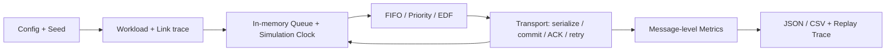

# สถาปัตยกรรม SAFER

M0/M1 ใช้ Python packages ภายใน monorepo เดียว Core ไม่มี network I/O, database,
wall clock หรือ UI dependency ผลทั้งหมดติดป้าย `simulated` และมาจากการประมวลผลจริง
ของ discrete-event engine ไม่ใช่ค่าตัวอย่างที่ hardcode เป็นผลทดลอง

- `safer_core`: immutable messages, queue state, scheduler Protocol และ baselines
- `safer_sim`: seeded generation, link segments, event heap, transport, CLI, trace replay
- `safer_metrics`: metric functions แยกจาก scheduler และใช้ simulation time เท่านั้น
- `contracts`: TypeScript contract เตรียมสำหรับ Dashboard ใน M4
- `tests`: unit tests ที่คำนวณมือและ CLI integration tests

เป้าหมาย M3/M4 (ยังไม่พัฒนา): Virtual devices → Mosquitto → Subscriber → SQLite WAL
→ Scheduler → Forwarder → FastAPI → PostgreSQL → ACK; Next.js อ่าน APIs.
Scheduler interface เดียวกันใช้ได้ทั้ง simulation และ integration adapters ในอนาคต
แต่ M1 ไม่อ้างว่าพิสูจน์ durability ของฐานข้อมูลจริงแล้ว

ขอบเขตสำคัญ: application ACK แยกจาก remote commit; ACK หายต้อง retry ID เดิม
และไม่เพิ่ม logical delivery. ลำดับ event ที่เวลาเดียวกันต้องคงที่และอธิบายใน methodology.
Cloud Run ใช้เฉพาะ remote HTTP ใน M6 เมื่อได้รับอนุญาต ไม่วาง SQLite Edge บน Cloud Run
